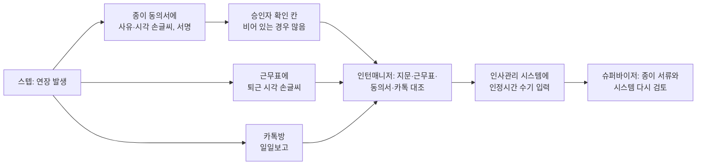
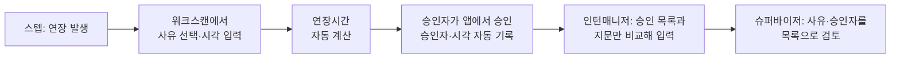

# 개선안: 스케줄 변경 동의서를 워크스캔 전자결재로

> 종이 "스케줄 변경 동의서"를 워크스캔 전자결재로 옮겨, 연장·변경 근무의 동의와 승인을 앱에 남기고 매일 밤 근태 대조와 검토 시간을 줄입니다.

| 항목 | 내용 |
|---|---|
| 대상 | 스텝, 인턴매니저, 슈퍼바이저, 승인자(인사담당자 또는 점장). 자세한 내용은 [페르소나.md](페르소나.md) |
| 범위 | 스케줄 변경 동의서(조기퇴근·연장근무·사전협의 변경·신규입사·지각·결근) |
| 범위 밖 | 출퇴근 인증 방식(지문), 종이 근무표, 온도·위생 체크표, 카톡 일일보고 전체 → 후속 과제 |
| 상태 | 초안. 사내 확인 항목(6절)과 측정값(4절)을 채워야 완성 |

## 1. 배경

- 회사는 이미 **워크스캔**을 쓰고 있지만, 근로계약 때 말고는 거의 쓰지 않습니다.
- 근태 기록은 **스텝 → 인턴매니저 → 슈퍼바이저 → 승인자** 순서로 올라갑니다.
  - **스텝**: 지문을 찍고, 근무시간이 바뀌면 종이 동의서에 사유·시각을 적고 서명합니다.
  - **인턴매니저**: 카톡방으로 일일보고를 받고, 매일 밤 **지문 기록 + 종이 근무표 + 종이 동의서 + 카톡 보고**를 대조해 사내 인사관리 시스템에 인정시간을 입력합니다.
  - **슈퍼바이저**: 인턴매니저가 기록한 서류를 검토하고 시스템을 최종 점검합니다. 누적 매출 대비 인건비도 봅니다.
  - **승인자**: 인사담당자 또는 점장이 변경·연장을 승인합니다.
- 워크스캔은 신규 입사, 근무 스케줄 변경, 연장·초과근무 신청을 **전자결재**로 처리한다고 소개되어 있습니다. ([App Store](https://apps.apple.com/kr/app/workscan/id1524912148), [전자신문](https://www.etnews.com/20210513000002))

## 2. 문제 (실제 서식에서 확인한 것)

근거: [실제-업무자료-분석.md](실제-업무자료-분석.md) (2026년 8월 1~12일 사진), 작성자 설명(카톡 일일보고, 슈퍼바이저 검토)

| # | 문제 | 근거 | 주로 겪는 사람 | 영향 |
|---|---|---|---|---|
| P1 | **승인 기록이 없음** | 사진 속 모든 날짜에서 동의서 "점장확인" 칸이 비어 있음 | 승인자, 슈퍼바이저 | 연장근무를 누가 승인했는지 근거가 남지 않음 |
| P2 | **연장시간 표기가 실제 시각과 안 맞음** | 20:00→21:40(1시간 40분)을 "1.5h", 21:00→21:10(10분)을 "1h"로 적은 사례 | 스텝, 인턴매니저 | 인턴매니저가 동의서 숫자를 믿지 못하고 지문 시각을 다시 확인 |
| P3 | **같은 변경이 여러 곳에 기록됨** | 근무표 손글씨 퇴근 시각, 동의서, 카톡 일일보고 | 스텝, 인턴매니저 | 스텝은 두 번 기록하고, 인턴매니저는 서로 다른 기록을 맞춰야 함 |
| P4 | **매일 밤 수기 대조·입력** | 시스템 화면 캡처가 밤 9시 이후, 변경구분 Y 줄이 여러 개 | 인턴매니저 | 업무 시간 증가, 입력 실수 가능성 |
| P5 | **검토할 때 종이를 다시 뒤짐** | 연장 사유·승인자가 종이에만 있고 점장확인 칸은 공란 | 슈퍼바이저 | 연장이 많은 날의 이유를 찾기 어렵고, 인건비 검토와 연결하기 어려움 |

## 3. Before → After

### Before: 지금

### After: 제안

※ After의 "자동 계산"과 "승인 목록"이 실제로 되는지는 6절에서 확인해야 합니다. 워크스캔 기록이 인사관리 시스템으로 자동으로 넘어가면 인턴매니저의 입력 단계도 줄어듭니다.

### 역할별 변화

| 역할 | 지금 | 바뀐 뒤 |
|---|---|---|
| 스텝 | 지문 + 종이 동의서 + (필요하면) 카톡 보고. 연장시간을 직접 계산 | 지문 + 앱 신청 한 번. 연장시간은 자동 계산 |
| 인턴매니저 | 지문, 근무표, 동의서, 카톡 네 곳을 대조해 입력 | 승인된 신청 목록과 지문만 비교해 입력 |
| 슈퍼바이저 | 종이 서류를 다시 넘겨보며 검토 | 신청 사유·시간·승인자를 목록으로 검토, 기간별로 모아 보기 |
| 승인자 | 종이 확인 칸에 서명해야 하지만 자주 비어 있음 | 앱 알림을 받고 승인·반려 (안 하면 미승인 목록에 남음) |

## 4. 기대 효과

측정값은 [측정-기록-양식.md](측정-기록-양식.md)로 1~2주 기록한 뒤 채웁니다.

| 지표 | 관련 페르소나 | 지금 (측정값) | 목표 | 근거 |
|---|---|---|---|---|
| 하루 대조·입력 시간 | 인턴매니저 | ___분 | ___분 이하 | 네 곳 대조 → 승인 목록 + 지문 |
| 하루 대조에 쓰는 자료 수 | 인턴매니저 | 4곳 | 2곳 | 지문 + 앱 승인 목록 |
| 동의서 승인 공란 비율 | 승인자 | ___% | 0% | 승인하지 않으면 미승인 목록에 남음 |
| 연장시간 표기 불일치 비율 | 스텝, 인턴매니저 | ___% | 0% | 시각 입력 시 연장시간 자동 계산 (설정 가능 여부 확인 필요) |
| 검토에서 수정된 건수 | 슈퍼바이저 | ___건/주 | 줄이기 | 입력 전에 승인 기록으로 확인 |

목표 숫자는 측정 후 현실적인 값으로 정합니다. 측정 전에 효과를 단정하지 않습니다.

## 5. 도입 단계 (제안)

| 단계 | 기간 | 할 일 | 끝났다고 보는 기준 |
|---|---|---|---|
| 0. 확인 | 1주 | 6절 사내 확인 항목에 답 받기 | 기능 사용 가능 여부 확정 |
| 1. 측정 | 1~2주 | 측정 양식으로 지금 방식 기록 | 기간 요약표 완성 |
| 2. 시범 | 2주 | 한 매장 주방에서 **종이 동의서와 앱 신청을 함께** 운영 | 종이와 앱 기록이 일치하는지 인턴매니저가 매일 비교 |
| 3. 전환 | 2주 | 앱만 사용, 종이 동의서는 예외 상황에만 | 같은 지표를 다시 측정해 Before와 비교 |
| 4. 확대 | — | 슈퍼바이저가 결과를 정리해 다른 파트·매장에 제안 | 결과 보고서 |

시범 기간에 종이와 앱을 같이 쓰는 이유는, 앱 기록만으로 동의·승인 근거가 충분한지 확인하기 위해서입니다.

## 6. 사내 확인 질문 목록

담당 부서(인사·노무, IT)에 보낼 질문입니다.

**워크스캔 기능**
1. 우리 회사 워크스캔 계약에 근무 스케줄 변경·연장근무 신청 **전자결재 기능**이 포함되어 있나요? 매장 단위로 켤 수 있나요?
2. 신청 사유를 지금 동의서와 같은 항목(조기퇴근, 연장근무, 사전협의 변경, 신규입사, 지각, 결근)으로 설정할 수 있나요?
3. 승인자를 점장 또는 인사담당자로 지정하고, 승인하지 않은 신청을 따로 볼 수 있나요? 인턴매니저·슈퍼바이저에게 조회 권한만 줄 수 있나요?

**기준과 연동**
4. 연장근무를 인정하는 기준이 무엇인가요? (30분 단위, 휴게 차감 여부 등) 이 기준을 워크스캔에 설정할 수 있나요?
5. 워크스캔의 승인 기록을 사내 인사관리 시스템(일일근태관리)으로 넘길 수 있나요? 안 된다면 엑셀로 내려받을 수 있나요?

**동의 근거**
6. 종이 동의서의 본인 서명을, 워크스캔 앱 신청 기록이 대신해도 되나요? 근로시간 변경에 대한 동의 근거로 충분한지 확인 부탁드립니다.
7. 종이 동의서와 워크스케줄의 보관 기간과 방법이 정해져 있나요? 전자 기록으로 바꾸면 보관은 어떻게 하나요?

## 7. 리스크와 대응

| 리스크 | 대응 |
|---|---|
| 바쁜 시간에 스텝이 앱 신청을 잊음 | 퇴근 전 인턴매니저·점장 확인 루틴, 시범 기간에는 종이 병행 |
| 휴대폰이 없거나 앱 사용이 서툰 스텝 | 인턴매니저 또는 점장이 대신 입력하는 예외 절차, 1장짜리 매장용 가이드 |
| 카톡 보고와 앱 신청이 겹쳐 이중 보고가 됨 | 시범 기간에 카톡 보고에서 변경·연장 내용은 빼고, 나머지 보고만 유지하는 방안 검토 |
| 앱 기록이 동의 근거로 인정되지 않음 | 6절 질문 6번 답을 받기 전에는 종이 서명을 유지 |
| 인사관리 시스템과 연동이 안 됨 | 인턴매니저가 승인 목록을 보고 입력하는 방식으로도 대조 자료는 줄어듦. 효과를 측정해 판단 |

## 8. 후속 과제

- 카톡 일일보고 중 근태 관련 내용을 워크스캔으로 옮기기
- 슈퍼바이저의 매출 대비 인건비 검토에 워크스캔 연장 기록 활용하기
- 출퇴근 GPS·QR 인증을 지문과 병행 ([매장용 출퇴근 가이드](매장용-출퇴근-가이드.md) 수정 필요)
- 종이 워크스케줄을 앱 스케줄로 전환 (동의 근거 확인 뒤)
- 온도·위생 체크표 전자화 (워크스캔 범위 밖, 별도 검토)
