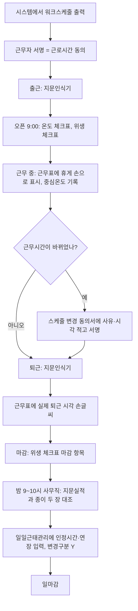

# 실제 업무 자료 분석

매장에서 실제로 쓰던 종이 서식과 사내 인사관리 시스템 화면 사진(2026년 8월 1일~12일, 20장)을 보고 정리했습니다.

> **개인정보 주의**: 원본 사진에는 직원 이름, 서명, 사번, 시급, 일급, 출력자 정보가 들어 있습니다. 원본은 이 저장소에 올리지 않았고, 이 문서에도 개인을 알아볼 수 있는 정보는 적지 않았습니다. 포트폴리오에 사진을 넣을 때는 이름·서명·사번·시급·급여·출력자 표시를 모두 가려 주세요.

## 1. 자료 목록

| 서식 | 형태 | 누가, 언제 | 무엇을 기록 |
|---|---|---|---|
| Kitchen 워크스케줄 | 시스템에서 **출력한 종이** | 매일, 근무자 전원 서명 | 직원별 계획 근무시간(8.0h 등), 시간 막대, 휴게 표시, 실제 퇴근 시각(손글씨) |
| 스케줄 변경 동의서 | 종이 | 매일, 변경이 생긴 직원 | 변경 사유(조기퇴근·연장근무·사전협의 변경·신규입사·지각·결근), 변경 전→후 시각, 본인 서명 |
| 지문인식기 | 기기 → 사내 인사관리 시스템 | 출퇴근 때 | 지문 출근·퇴근 시각 ("지문실적") |
| 일일근태관리 (사내 인사관리 시스템) | 웹 시스템 | 매일 밤, 사무직 | 계획·지문실적을 보고 **인정시간**(출근·퇴근·휴식·근무)과 연장·심야 입력, 일마감 |
| 온도 체크표 | 종이 | 오픈 근무자 9:00, 조리 담당 오전·오후 | 냉장·냉동고 14대 온도, 가열 메뉴 중심온도(80°C 이상) |
| 일일 위생/안전 체크표 | 종이 | 오픈 9:00, 마감 21~22시 | 개인위생·검수·식중독 예방·안전·청소 항목 O/X/N/A |

## 2. 하루 흐름 (사진으로 확인한 순서)

## 3. 서식별로 보이는 막히는 지점

### ① Kitchen 워크스케줄 (종이)
- 근무표의 **"실적" 칸이 비어 있습니다.** 실제 퇴근 시각은 시간 막대 끝에 화살표와 손글씨로만 적혀 있습니다.
- 휴게 시간은 막대 위에 동그라미·체크 기호로 표시합니다. 몇 분을 쉬었는지는 기호만으로 알기 어렵습니다.
- 당일 신규 입사자는 근무표에 줄을 손으로 추가하고, 근무시간·휴게는 **포스트잇**으로 붙여 둔 사례가 있습니다.
- 근무표 하단에는 "서명으로 근로시간·연장·야간·휴일 근로에 동의한다"는 문구가 있습니다. 그래서 **이 종이가 동의 근거 역할**을 합니다. 종이를 없애려면 동의 근거를 대신 남길 방법이 필요합니다.

### ② 스케줄 변경 동의서 (종이)
- 사진 속 모든 날짜에서 **"점장확인" 칸이 비어 있습니다.**
- 괄호 안 연장시간과 실제 시각 차이가 맞지 않는 경우가 있습니다.

  | 변경 전 → 후 | 시각 차이 | 적힌 시간 |
  |---|---|---|
  | 11:00–20:00 → 11:00–21:40 | 1시간 40분 | 1.5h |
  | 12:00–21:00 → 12:00–21:10 | 10분 | 1h |
  | 08:00–17:00 → 08:00–19:15 | 2시간 15분 | 1.5h |

  연장을 30분 단위로 인정하는지, 휴게를 빼는지 등 **적는 기준이 서식에 없습니다.** 사무직은 이 숫자를 그대로 믿을 수 없어서 지문 시각을 다시 확인해야 합니다.
- 한 사람이 연장근무와 지각에 동시에 체크한 줄처럼, 사유가 여러 개인 경우도 한 칸에 몰아 적습니다.
- 같은 날의 변경 내용이 **근무표 손글씨와 동의서 두 곳**에 나뉘어 있습니다.

### ③ 지문인식기 + 일일근태관리 (시스템)
- **지문 누락**: 근무한 날인데 지문실적(출근·퇴근)이 비어 있는 직원이 있고, 출근 지문만 있고 퇴근 지문이 없는 경우도 있습니다. 이때 인정시간은 종이 기록을 보고 입력합니다.
- **시각 맞추기**: 지문 시각을 정시로 맞춰 인정시간을 넣습니다(예: 지문 10:58 → 인정 11:00, 지문 22:01 → 인정 22:00). 수정한 줄에는 "변경구분 Y"가 붙습니다. 한 화면에서 Y가 여러 줄입니다.
- **입력 시간대**: 화면 캡처 시각이 밤 9시 20분~9시 50분입니다. 마감 직후 매일 대조·입력하고 있습니다.
- 시스템 메뉴에 **"지문 누락사유 리스트"**, "주40시간 근무현황", "일마감"이 있습니다. 누락 사유를 시스템 안에서 관리하는 기능이 이미 있다는 뜻입니다. 지금 이 기능을 쓰고 있는지는 확인이 필요합니다.

### ④ 온도 체크표·일일 위생/안전 체크표 (종이)
근태는 아니지만 같은 "종이에 손으로 쓰고 보관하는" 문제가 있습니다.
- 상단 **결재란(Chef 확인·점장 확인)이 비어 있습니다.**
- 체크 시각이 매일 9:00으로 같고, 위생 항목은 대부분 매일 O입니다. 실제로 점검했는지 종이만으로는 구분하기 어렵습니다. 형식적인 체크인지는 현장에서 확인해야 판단할 수 있습니다.
- 미판매 메뉴는 X로 지우는 등 표기 방식이 사람마다 조금씩 다릅니다.
- 온도 체크표에는 "보존기간 2년"이라고 적혀 있습니다. 종이로 2년을 보관하고 찾아야 합니다.

## 4. 지문 시스템은 워크스캔인가?

**아닌 것으로 보입니다.**
- 사진 속 지문 기록은 **사내 인사관리 시스템**(인사관리-영업직군, 근태관리 > 지문인식기 메뉴)에 들어 있습니다. 워크스캔 앱 화면이 아닙니다.
- 워크스캔은 출시 때 **지문 인식기 없이 GPS·QR코드로 출퇴근을 인증**한다고 소개됐습니다. ([전자신문](https://www.etnews.com/20210513000002))
- 즉 지금 구조는 **출퇴근은 지문인식기 + 사내 시스템, 근로계약은 워크스캔**으로 나뉘어 있습니다. 두 시스템이 연동되는지는 사진과 공개 자료로는 확인되지 않습니다. 사내 담당 부서에 물어봐야 합니다.

## 5. 개선안 방향 (워크스캔을 계약 외에도 쓰기)

공개 자료로 확인된 워크스캔 기능만 연결했습니다. 실제로 켤 수 있는지는 회사 계약·설정에 따라 다릅니다.

| 지금 (종이·수기) | 워크스캔으로 옮길 수 있는 기능 | 기대 효과 | 확인할 점 |
|---|---|---|---|
| 종이 워크스케줄 출력·서명 | 근무 스케줄 등록·공유 (주 52시간 기준) | 출력·서명 없이 앱에서 확인, 동의 기록이 남음 | 앱 안 확인이 서명(동의)을 대신할 수 있는지 |
| 스케줄 변경 동의서 | 근무 스케줄 변경·연장근무 신청 **전자결재** | 사유·시각·승인자가 자동 기록, 점장확인 누락 방지, 연장시간 자동 계산 | 연장 인정 기준(30분 단위 등)을 앱에 설정할 수 있는지 |
| 지문 누락 → 종이 보고 수기 입력 | GPS·QR 출퇴근 (지문과 병행 또는 대체) | 누락·불일치 감소, 밤마다 하던 대조 시간 감소 | 워크스캔 기록이 사내 인사관리 시스템으로 넘어가는지 |
| 온도·위생 체크표 | (워크스캔 기능으로 확인되지 않음) | — | 사내 다른 시스템이나 별도 도구 검토 |

**우선순위 제안**
1. **스케줄 변경 동의서 → 전자결재**: 매일 생기고, 점장확인 누락과 시간 표기 불일치가 사진으로 확인됩니다. 개선 효과를 보여 주기 가장 쉽습니다.
2. **출퇴근 GPS·QR 병행**: 지문 누락을 줄일 수 있지만, 사내 시스템 연동을 먼저 확인해야 합니다.
3. **종이 워크스케줄 → 앱 스케줄**: 동의 근거를 대신할 방법이 정해진 뒤에 진행합니다.

## 6. 포트폴리오에 쓸 때

- 사진은 **이름·서명·사번·시급·일급·출력자 표시를 가린 뒤** `docs/images/`에 넣습니다.
- "Before(종이 서식) → After(워크스캔 화면 또는 흐름도)" 구조로 보여 주면 이해하기 쉽습니다.
- 3절의 숫자(시각 차이 표, 결재란 공란)는 문제를 보여 주는 근거로 쓸 수 있습니다. 회사 내부 자료이므로 외부 공개 전에 회사 정책을 확인하세요.
