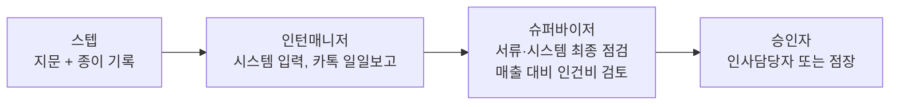

# 페르소나

개선안([스케줄 변경 → 워크스캔 전자결재](개선안-스케줄변경-전자결재.md))에 관련된 사람들을 4명의 페르소나로 정리했습니다. 근태 기록이 **스텝 → 인턴매니저 → 슈퍼바이저 → 승인자** 순서로 올라가는 흐름입니다.

> **가상 인물입니다.** 작성자가 설명한 역할 구분과 실제 서식 사진([실제-업무자료-분석.md](실제-업무자료-분석.md))을 바탕으로 만든 **합성 인물**입니다. 특정 직원이 아니며 이름도 붙이지 않았습니다. "한마디"는 이해를 돕기 위해 지어낸 말입니다.

## 근태 기록이 올라가는 흐름

## 한눈에 보기

| # | 페르소나 | 하는 일 | 쓰는 것 | 개선안에서의 역할 |
|---|---|---|---|---|
| P1 | 스텝 | 지문을 찍고, 근무표·동의서에 수기로도 기록 | 지문인식기, 종이 근무표, 종이 동의서 | **신청자** |
| P2 | 인턴매니저 | 근태를 시스템에 입력하고, 카톡방으로 일일보고를 받음 | 인사관리 시스템(일일근태관리), 카톡방, 종이 서류 | **1차 정리·입력** |
| P3 | 슈퍼바이저 | 인턴매니저가 기록한 서류를 검토하고 시스템을 최종 점검, 누적 매출 대비 인건비 검토 | 종이 서류, 인사관리 시스템, 매출 자료 | **검토자** |
| P4 | 승인자 (인사담당자 또는 점장) | 근무시간 변경과 연장을 최종 승인 | 동의서 점장확인란, 결재란 | **승인자** |

---

## P1. 스텝

- **소개**: 시급제로 주방에서 일하는 스텝. 출퇴근 때 지문을 찍고, 근무시간이 바뀌면 종이에도 적는다.
- **하루 흐름**: 근무표에 서명 → 지문 출근 → 근무 중 휴게 표시 → 연장이 생기면 동의서에 변경 전→후 시각과 연장시간을 적고 서명 → 지문 퇴근
- **목표**: 일한 만큼 정확히 받기, 마감 후 빨리 퇴근하기
- **막히는 지점**
  - 지문과 종이에 **같은 내용을 두 번** 기록함
  - 동의서에 연장시간을 직접 계산해 적어야 함 (실제로 시각 차이와 안 맞는 표기가 있었음)
  - 지문이 안 찍혀도 본인은 모르고 지나감
- **개선안에서 바라는 것**: 앱에서 사유만 고르면 연장시간이 자동 계산되고, 종이에 다시 쓰지 않는 것
- **걱정**: 바쁜 마감 시간에 앱 입력이 하나 더 늘어나는 것
- **한마디(가상)**: "지문도 찍고 종이에도 쓰는데, 몇 시간 더 했는지 계산까지 해야 해요?"

## P2. 인턴매니저

- **소개**: 매장 근태를 시스템에 입력하고, 카톡방으로 일일보고를 받는 인턴매니저
- **하루 흐름**: 스텝들의 종이 기록 모으기 → 카톡방 일일보고 확인 → 밤에 지문실적과 종이 서류를 대조 → 일일근태관리에 인정시간 입력(변경구분 Y) → 슈퍼바이저에게 넘김
- **목표**: 빠뜨리지 않고 정확하게 입력하기, 검토에서 지적받지 않기
- **막히는 지점**
  - 정보가 **지문, 종이 근무표, 종이 동의서, 카톡 일일보고** 네 곳에 흩어져 있음
  - 지문 누락이나 시각 불일치가 있으면 누구에게 다시 물어봐야 하는지부터 찾아야 함
  - 카톡 보고는 대화에 묻혀서 나중에 다시 찾기 어려움
- **개선안에서 바라는 것**: 승인된 변경 신청이 한 목록에 모여 있어서, 그것만 보고 입력하는 것
- **걱정**: 앱이 하나 더 생겨서 확인할 곳이 다섯 곳이 되는 것 (인사관리 시스템과 연동이 안 될 때)
- **한마디(가상)**: "지문, 종이 두 장, 카톡까지 맞춰 보는 게 매일 밤 일이에요."

## P3. 슈퍼바이저

- **소개**: 인턴매니저가 정리한 서류를 검토하고 시스템을 최종 점검하는 슈퍼바이저. 누적 매출 대비 인건비도 본다.
- **하루·주간 흐름**: 인턴매니저 입력 결과와 종이 서류를 비교 검토 → 시스템 최종 점검 → 누적 매출과 인건비 비교
- **목표**: 근태 기록이 정확한지 확인하고, 인건비가 매출에 비해 적정한지 관리하기
- **막히는 지점**
  - 검토하려면 **종이 서류를 다시 넘겨봐야** 함
  - 연장이 왜 생겼는지, 누가 승인했는지 종이만으로는 바로 알기 어려움 (점장확인 칸 공란)
  - 근무표 양식에 매출액·예상 인건비 칸이 있지만, 사진 속 근무표에서는 비어 있음 → 인건비 검토는 다른 자료로 따로 해야 할 가능성 (확인 필요)
- **개선안에서 바라는 것**: 연장·변경 신청의 사유, 시간, 승인자가 한눈에 보이고, 기간별로 모아 볼 수 있는 것
- **걱정**: 매장마다 기록 방식이 다르면 비교가 안 되는 것
- **한마디(가상)**: "연장이 많았던 날, 왜 많았는지를 종이 뒤져서 찾아야 해요."

## P4. 승인자 (인사담당자 또는 점장)

- **소개**: 근무시간 변경과 연장근무를 최종 승인하는 사람. 매장에서는 점장, 본사에서는 인사담당자.
- **흐름**: 스케줄 변경 동의서 "점장확인", 체크표 결재란에 확인
- **목표**: 승인 근거를 남기고, 법 기준(연장근무 동의 등)을 지키기
- **막히는 지점**
  - 사진 속 모든 날짜에서 동의서 점장확인 칸과 체크표 결재란이 비어 있음 → 확인 시점을 놓치거나 나중에 몰아서 봄
  - 종이 서명을 앱 기록으로 바꿔도 동의 근거가 되는지 판단해야 함 (인사담당자)
- **개선안에서 바라는 것**: 승인할 건이 생기면 알림이 오고, 미승인 건이 목록으로 남는 것
- **걱정**: 알림이 너무 많아지는 것, 전자 기록의 증빙·보관
- **한마디(가상)**: "사인할 타이밍을 매번 놓쳐요. 그리고 앱 기록이 근거로 인정되는지부터 확인해야 해요."

---

## 대표 프로필 고르기

개선안과 매장용 가이드를 **누구를 중심으로** 쓸지 정하기 위한 비교입니다.

| 기준 | P1 스텝 | P2 인턴매니저 | P3 슈퍼바이저 | P4 승인자 |
|---|---|---|---|---|
| 빈도 | 높음 (연장 잦음) | 매일 | 매일~주간 | 높음 |
| 문제 크기 | 중간 (이중 기록, 계산) | 높음 (네 곳 대조) | 높음 (검토 근거 부족) | 높음 (승인 근거 공란) |
| 개선안 효과 | 높음 (자동 계산) | 높음 (승인 목록 하나로) | 중간~높음 (사유·승인자 조회) | 높음 (알림·미승인 목록) |
| 근거 자료 | 동의서 사진 | 시스템 화면 + 측정 양식 | 근무표 인건비 칸 (확인 필요) | 점장확인 공란 사진 |

※ 평가는 사진과 업무 흐름을 보고 매긴 정성적 판단입니다. 측정 결과가 나오면 다시 매깁니다.

## 선택한 대표 프로필

**보류.** 대표 프로필은 나중에 **작성자 본인의 역할을 중심으로** 다시 정합니다. 그때 작성자가 위 4명 중 어디에 해당하는지(또는 새 페르소나가 필요한지)부터 정리합니다.
