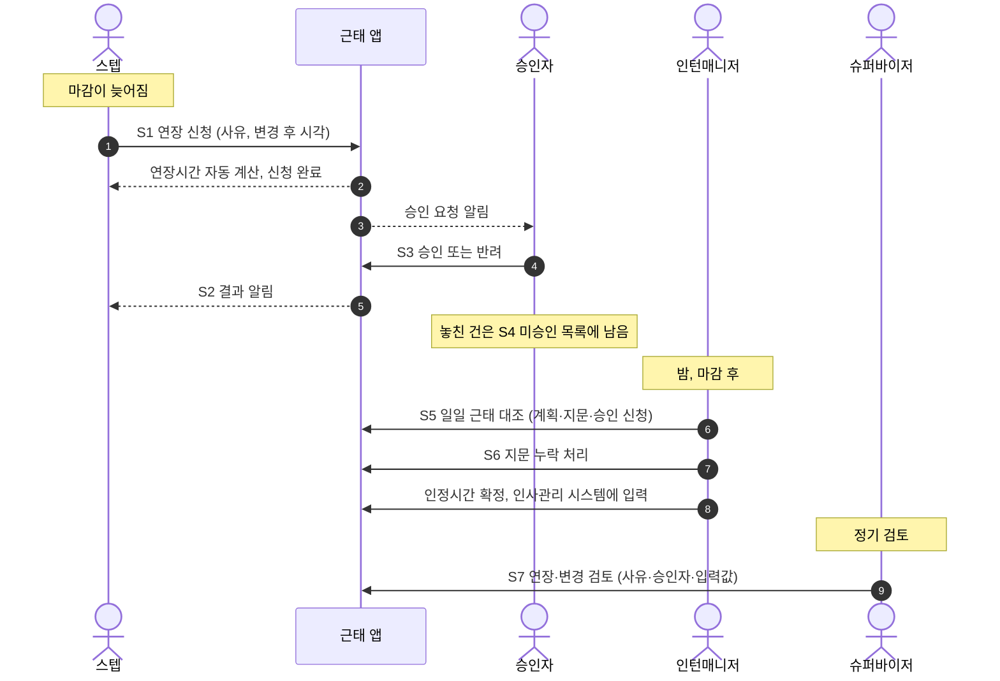
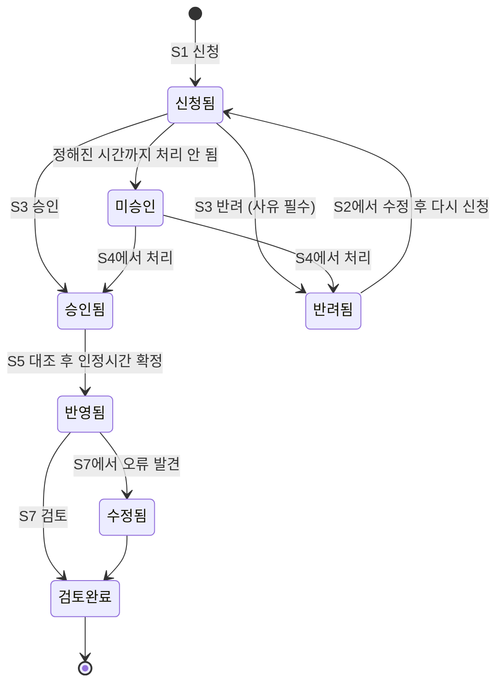
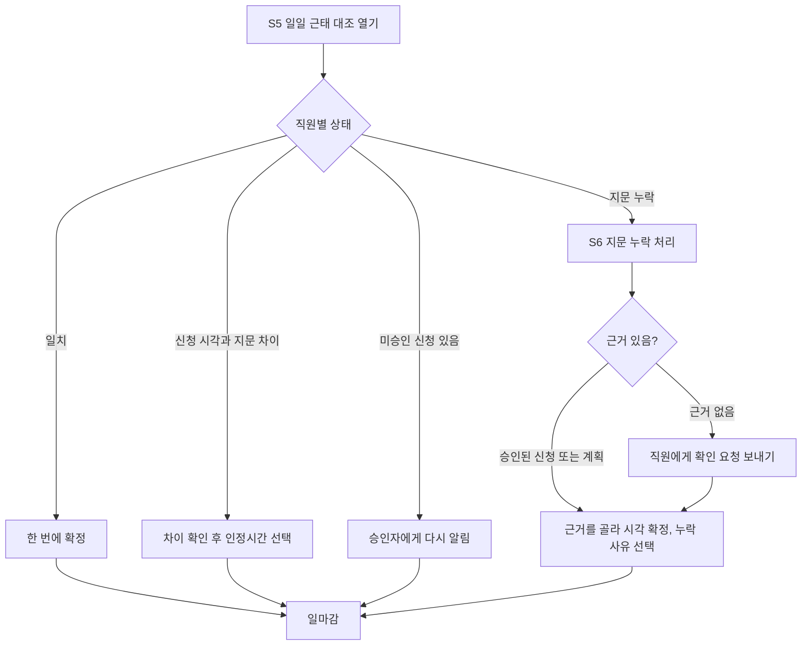

# 화면 정의와 사용자 흐름도

[최종 JTBD 과업 5개](JTBD-과업후보.md)(J1~J5)를 화면으로 옮겼습니다.

> **제안 화면입니다.** 워크스캔에 이 화면들이 실제로 있다는 뜻이 아닙니다. 과업을 끝내려면 어떤 화면이 필요한지 정의한 것입니다. 워크스캔의 전자결재 기능으로 어디까지 구현할 수 있는지는 [개선안](개선안-스케줄변경-전자결재.md) 6절 질문으로 확인해야 합니다.
>
> **성공 기준의 숫자는 가설입니다.** 실제 측정 전 목표값이며, 도입할 때 [측정 계획](측정-기록-양식.md)으로 검증합니다.

**클릭 가능한 와이어프레임**: https://claude.ai/artifact/8VcacdESZg8mKSicw4GsTw (가상 데이터, 현재 작성자만 열람 가능)
**사용성 점검 결과**: [휴리스틱-점검.md](휴리스틱-점검.md)

## 1. 화면 목록

| 화면 | 이름 | 사용자 | 과업 | 기기 |
|---|---|---|---|---|
| S1 | 연장·변경 신청 | 스텝 (예외: 인턴매니저 대리 입력) | J1 | 휴대폰 |
| S2 | 내 신청 현황 | 스텝 | J1 | 휴대폰 |
| S3 | 승인 요청 상세 | 승인자 | J2 | 휴대폰 |
| S4 | 미승인 목록 | 승인자 | J2 | 휴대폰 |
| S5 | 일일 근태 대조 | 인턴매니저 | J3 | 매장 PC |
| S6 | 지문 누락 처리 | 인턴매니저 | J4 | 매장 PC |
| S7 | 연장·변경 검토 | 슈퍼바이저 | J5 | PC |

## 2. 전체 흐름도

### 하루 흐름 (누가, 언제, 어느 화면에서)

### 신청 한 건의 상태 변화

### 인턴매니저의 밤 대조 흐름 (J3, J4)

## 3. 화면별 정의

### S1. 연장·변경 신청 (J1)

| 항목 | 내용 |
|---|---|
| 사용자 | 스텝 |
| 진입 상황 | 마감이 늦어져 퇴근 직전, 주방에서 휴대폰으로 |
| 목적 | 더 일한 시간을 정확히 남기고 바로 퇴근하기 |
| 없앨 불편 | 종이 동의서에 시각과 연장시간을 직접 계산해 적고 서명하기 |

**핵심 요소**
- **오늘 내 계획 근무시간** (자동 표시, 예: 11:00~20:00)
- **사유 선택** (한 번 탭): 연장근무 / 조기퇴근 / 사전협의 변경 / 지각 / 결근 / 신규입사
- **변경 후 시각** 입력: 종료 시각만 바꾸는 경우가 많으므로 종료 시각을 먼저 보여 줌
- **연장시간 자동 계산** 결과 (예: "1시간 40분"). 회사 인정 기준(30분 단위 등)이 정해지면 그 기준으로 표시
- **동의 문구** 확인 체크: 지금 종이 근무표 하단 문구("근로시간·연장에 동의")를 그대로 옮김
- **신청** 버튼

**예외**
- 휴대폰이 없는 스텝: 인턴매니저가 S1을 **대리 입력**하고, 다음 출근 때 스텝이 S2에서 확인

**성공 기준 (가설)**
- 신청을 30초 안에 끝냄
- 연장시간을 사람이 계산하지 않음 (표기 불일치 0건)

### S2. 내 신청 현황 (J1)

| 항목 | 내용 |
|---|---|
| 사용자 | 스텝 |
| 진입 상황 | 신청 직후, 또는 결과 알림을 받았을 때 |
| 목적 | 내 신청이 승인됐는지 확인하기 |
| 없앨 불편 | 종이를 내고 나면 처리됐는지 알 수 없음 |

**핵심 요소**
- 신청 목록: 날짜, 사유, 변경 전→후 시각, 연장시간, **상태**(신청됨/승인됨/반려됨/미승인)
- 반려된 건: 반려 사유 + **수정 후 다시 신청** 버튼
- 대리 입력된 건: **내용 확인** 버튼

**성공 기준 (가설)**
- 스텝이 자기 연장 기록을 따로 묻지 않고 확인할 수 있음

### S3. 승인 요청 상세 (J2)

| 항목 | 내용 |
|---|---|
| 사용자 | 승인자 (점장 또는 인사담당자) |
| 진입 상황 | 영업 중 알림을 받았을 때 |
| 목적 | 그 자리에서 승인하고 근거 남기기 |
| 없앨 불편 | 종이 확인 칸에 서명할 타이밍을 놓침 |

**핵심 요소**
- 신청자, 사유, 계획 → 변경 시각, 연장시간
- 오늘 이 직원의 누적 근무시간, 이번 주 누적 (주 52시간 기준 확인용)
- **승인** / **반려** 버튼. 반려 시 사유 입력 필수
- 승인하면 승인자와 시각이 자동 기록됨

**성공 기준 (가설)**
- 알림을 받고 1분 안에 처리
- 승인 근거(승인자, 시각)가 모든 건에 남음

### S4. 미승인 목록 (J2)

| 항목 | 내용 |
|---|---|
| 사용자 | 승인자 |
| 진입 상황 | 마감 무렵, 또는 미승인 알림을 받았을 때 |
| 목적 | 놓친 신청을 한 번에 처리하기 |
| 없앨 불편 | 몰아서 보거나 비워 두는 확인 칸 |

**핵심 요소**
- 처리하지 않은 신청 목록 (오래된 순)
- 여러 건 선택 후 **일괄 승인**
- 미승인 건수 배지 (홈 화면에 표시)

**성공 기준 (가설)**
- 일마감 전 미승인 0건

### S5. 일일 근태 대조 (J3)

| 항목 | 내용 |
|---|---|
| 사용자 | 인턴매니저 |
| 진입 상황 | 마감 후 밤 9시 이후, 매장 PC 앞 |
| 목적 | 직원별 인정시간을 확정하고 일마감 끝내기 |
| 없앨 불편 | 지문·종이 근무표·종이 동의서·카톡 네 곳 대조 |

**핵심 요소**
- 직원별 한 줄: **계획 시각 | 지문 시각 | 승인된 신청 | 제안 인정시간 | 상태**
- 상태 표시: ✅ 일치 / ⚠️ 지문 누락 / ⚠️ 신청과 지문 차이 / ⏳ 미승인 신청 있음
- ⚠️·⏳만 모아 보기 필터
- 일치하는 줄은 **한 번에 확정**
- 미승인 건은 **승인자에게 다시 알림** 버튼
- 확정 결과를 인사관리 시스템에 옮기기 쉽게 정리 (연동이 안 되면 입력용 목록, 되면 자동 반영)

**성공 기준 (가설)**
- 대조에 보는 자료가 2곳(지문 + 앱)으로 줄어듦
- 하루 대조·입력 시간이 측정값보다 줄어듦

### S6. 지문 누락 처리 (J4)

| 항목 | 내용 |
|---|---|
| 사용자 | 인턴매니저 |
| 진입 상황 | S5에서 ⚠️ 지문 누락을 눌렀을 때 |
| 목적 | 실제 출퇴근 시각을 근거 있게 확정하기 |
| 없앨 불편 | 근거가 종이·카톡에 흩어져 있고 직원에게 따로 물어야 함 |

**핵심 요소**
- 누락된 항목 (출근 / 퇴근)
- **근거 후보**를 한 화면에: 계획 시각, 승인된 신청 시각, 같은 날 다른 쪽 지문 시각
- 근거를 골라 **시각 확정**
- **누락 사유** 선택 (사내 인사관리 시스템의 "지문 누락사유" 항목과 맞춤)
- 근거가 없으면 **직원에게 확인 요청** 보내기 → 직원이 S2에서 시각 입력

**성공 기준 (가설)**
- 직원에게 따로 연락하지 않고 처리하는 비율이 늘어남
- 모든 누락 건에 근거와 사유가 남음

### S7. 연장·변경 검토 (J5)

| 항목 | 내용 |
|---|---|
| 사용자 | 슈퍼바이저 |
| 진입 상황 | 정기 검토 때, PC에서 |
| 목적 | 연장·변경이 정당한지 확인하고 입력 오류 바로잡기 |
| 없앨 불편 | 사유·승인자가 종이에만 있어 다시 뒤져야 함 |

**핵심 요소**
- 기간·직원·사유 **필터**
- 목록: 날짜, 직원, 사유, 연장시간, **승인자, 승인 시각**, 인정시간 입력값, **일치 여부**
- 날짜별 연장시간 합계 (인건비 검토의 출발점)
- 오류 발견 시 **수정 요청** (인턴매니저에게)
- 검토 완료 표시

**성공 기준 (가설)**
- 종이를 다시 찾지 않고 검토 완료
- 연장 사유를 알 수 없는 건 0건

## 4. 과업 → 화면 → 불편 연결 확인

| 과업 | 화면 | JTBD의 불편 | 화면에서 없애는 방법 |
|---|---|---|---|
| J1 마감 연장 기록 | S1, S2 | 종이에 직접 계산해 적고 서명 | 사유 탭 + 시각 입력, 연장시간 자동 계산, 동의 체크 |
| J2 변경·연장 승인 | S3, S4 | 서명 타이밍을 놓침 | 알림, 그 자리 승인, 미승인 목록 |
| J3 매일 밤 대조·입력 | S5 | 네 곳 대조 | 한 줄에 계획·지문·승인 신청, 일치 건 일괄 확정 |
| J4 지문 누락 처리 | S6 | 근거 흩어짐, 직원에게 다시 물음 | 근거 후보 한 화면, 확인 요청 기능 |
| J5 입력 결과 검토 | S7 | 종이 다시 뒤짐, 승인 칸 공란 | 사유·승인자·입력값 목록, 필터 |

## 5. 확인이 필요한 점

- 워크스캔 전자결재로 S1~S4를 어디까지 만들 수 있는지 (개선안 6절 질문 1~3)
- S1의 연장시간 계산 기준 (개선안 6절 질문 4)
- S5·S6 결과를 사내 인사관리 시스템에 자동 반영할 수 있는지 (개선안 6절 질문 5). 안 되면 S5는 "입력용 정리 화면"으로 쓰임
- S1의 동의 체크가 종이 서명을 대신할 수 있는지 (개선안 6절 질문 6)
- S6의 "직원에게 확인 요청"은 워크스캔 공개 자료에서 확인되지 않은 기능이므로 대안(알림 메시지 등) 검토 필요
